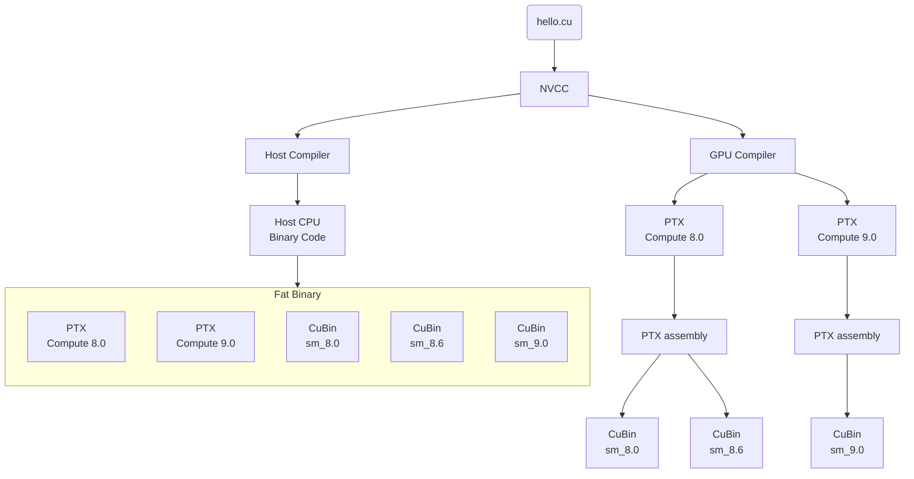
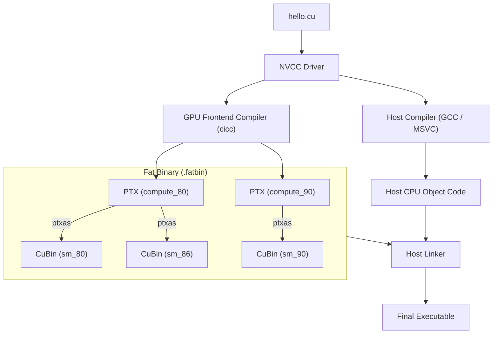

# Notes of GPU Programming

```text
Date : 13 Oct 2026
```

## How CUDA code is compiled ?

The below is a flowchart that shows how an cuda program in compiled.


> [!NOTE]
> PTX is virtual GPU code

The below is refined diagram by **Gemini**.


---

## CUDA OBJECT DUMP

`cudaobjdump` is an NVIDIA CUDA Toolkit command-line utility used to inspect, disassemble, and extract low-level device code from compiled CUDA binaries (.o, .a, .fatbin, and executables).

| Flag | Description / Output |
| --- | --- |
| **`-sass`** | Native GPU machine assembly (SASS), register usage, & instruction scheduling |
| **`-ptx`** | Architecture-independent intermediate assembly (PTX) |
| **`-source`** | High-level CUDA C/C++ source interleaved with SASS (compiled with `-lineinfo`) |
| **`-elf`** | GPU ELF metadata: symbol tables, sections, shared memory, & register allocation |
| **`-fatbin`** | Fatbinary container details and target GPU architectures (e.g., `sm_80`, `sm_90`) |

```bash
cudaobjdump -sass my_app                      # Dump native GPU assembly
cudaobjdump -source my_app                    # Interleave C++ source with SASS
cudaobjdump -gpu sm_80 -sass my_app           # Target specific GPU architecture
```

> [!NOTE]
> With `nvcc` , you can compile your code to compute capability to 8.0 on a machine that has GPU compute capability 7.0 , but you wont be able to run

---

## Some Questions

> [!QUESTION] How do we display all architectures supported by NVCC?
>
> **Virtual architectures (`compute_XX`):**
> ```bash
> nvcc --list-gpu-arch
> ```
>
> **Real GPU device codes (`sm_XX`):**
> ```bash
> nvcc --list-gpu-code
> ```


> [!QUESTION] `nvcc -ptx code.cu` what is the output of this command
> It compiles `code.cu` into  **PTX intermedate** (architecture-independent intermediate representation) and generates a file named **`code.ptx`** in the current directory. It does not produce an executable or object file.

>[!NOTE]
 `reduce_add_sync` can only run in GPU with compute capability 8.0 or higher.


---
