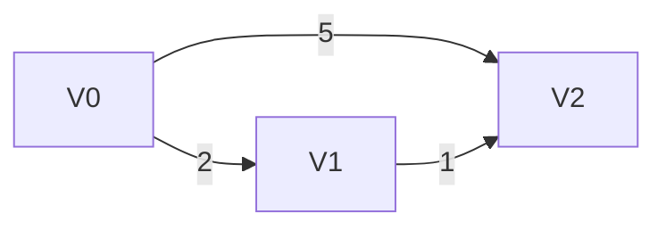

# Notes of GPU Programming

```text
Date : 22 Oct 2026
```
---

## Floating Point Representations

The difference btw FP32, TF32 (uses 19 bits), BF16 (all of them have 8 bits exponents).

FP16 : it is available from cuda compute capability 7.0 onwards (Volta).

BF16 is available form Amphere.

Both types of FP8 (E4M3 , E5M2) are available from Hopper (H100).

The max value that can be stored in FP32, TF32, BF32 is aproximately $ 3.4 \times 10^{38} $

>[!NOTE] use header : `<cuda_fp16.h>` to use half data type.
> Regularly this half data type is only supported for device code , not host (but recent CPUs also support them some intel chips.)

> The Amphere diver can emulate BF16  with SPs , instead of using Tensors cores , eventhough it does not support the BF16.  (it can compile and run.)

----

- Look into `grid.sync()` that we implemented for block wise barrier.

- Look into Pre-emptive of thread block , how no of blocks and threads can increase and decrease , due to fixed sm count. Like more blocks less threads , can be scheduled by SMs.

---

## Gather-Apply-Scatter (GAS) Programming Model


The **Gather-Apply-Scatter (GAS)** model is a parallel programming abstraction widely used in graph processing frameworks (such as PowerGraph, Gunrock, and Galois) on GPUs and distributed systems. It breaks complex parallel graph computations into three distinct, fine-grained computation phases per vertex or edge.

---

### Phase-by-Phase Breakdown


#### Gather

* **Operation**: Reads values along incoming edges $N_{in}(v)$ to target vertex $v$ and reduces them into a single temporary accumulation variable using an associative/commutative operator ($\sum$, $\min$, $\max$).
* **GPU Context**: Typically structured as **edge-parallel**. GPU threads read neighboring vertex state across memory buffers ($D[u] + w(u,v)$) and write to intermediate per-vertex buffers via atomic operations or reduction trees.

#### Apply

* **Operation**: Updates the local state of vertex $v$ based on the result of the Gather phase and its existing value:

$$D_{new}[v] = \text{Apply}(D_{old}[v], \text{accum}_v)$$


* **GPU Context**: Structured as **vertex-parallel**. Reads the accumulated gather value for each vertex, writes to the vertex property array, and sets a boolean flag indicating whether the vertex state changed.

>[!Note]
Apply should be permuation invarient function

#### Scatter

* **Operation**: Propagates updated state to outgoing neighbors $N_{out}(v)$ or pushes neighbor vertices into the active queue for the next iteration.
* **GPU Context**: Evaluates modified vertices and writes their outgoing edges into a dynamic active frontier queue (e.g., using prefix-sum or GPU `atomicAdd`).

---

### Why the GAS Model is Used in GPU Computing

1. **Structured Parallelism for Irregular Graphs**: Real-world graphs (social networks, web graphs) have non-uniform power-law degree distributions. GAS separates edge-centric operations (which scale with graph density) from vertex-centric operations (which scale with node count), balancing workload distribution across GPU warps.
2. **Lock-Free State Synchronization**: By isolating aggregation (Gather) from local updates (Apply), GAS prevents race conditions on vertex properties without needing explicit global thread locks.
3. **Frontier-Based Execution**: Instead of running operations across all vertices every iteration, the Scatter phase dynamically tracks active sub-graphs (frontiers), significantly reducing idle GPU thread execution.

---


### SSSP Algorithm Overview using GAS

In the Single-Source Shortest Path (SSSP) problem, given a weighted graph $G = (V, E)$ and a source vertex $S$, the goal is to find the minimum distance from $S$ to every vertex $v \in V$.

We maintain:

* **Distance array** $D[v]$ initialized to $0$ for $v = S$, and $\infty$ for all other vertices $v \neq S$.
* **Active frontier** representing vertices or edges that need processing in the current iteration.

#### The GAS Phases for SSSP

For a target vertex $v$ with incoming neighbors $u \in N_{in}(v)$:

1. **Gather**: Each incoming edge $(u, v)$ calculates a candidate path length $D[u] + w(u,v)$. The Gather step uses a **$\min$ reduction** across all incoming edges to find the shortest potential distance to $v$:

$$\text{accum}_v = \min_{u \in N_{in}(v)} \big( D[u] + w(u, v) \big)$$


2. **Apply**: Vertex $v$ compares the gathered minimum distance against its current distance $D[v]$. If a shorter path is found, it updates $D[v]$ and marks itself as updated:

$$D[v] = \min(D[v], \text{accum}_v)$$


3. **Scatter**: If vertex $v$'s distance was updated during **Apply**, it notifies its outgoing edges $(v, w)$ to activate target neighbors $w \in N_{out}(v)$ for the next iteration.

---

## 3. Concrete Example Walkthrough

Consider a graph with 3 vertices ($V_0, V_1, V_2$) and directed weighted edges:

* $V_0 \xrightarrow{w=2} V_1$
* $V_0 \xrightarrow{w=5} V_2$
* $V_1 \xrightarrow{w=1} V_2$

**Source**: $V_0$

**Initial Distances**: $D = [0, \infty, \infty]$




#### Iteration 1

* **Active Set**: $V_0$ updated (at start).
* **Gather Phase**:
* $V_1$ gathers from incoming edge $(V_0, V_1)$: $0 + 2 = 2$.
* $V_2$ gathers from incoming edge $(V_0, V_2)$: $0 + 5 = 5$.


* **Apply Phase**:
* $V_1$: $D[V_1] = \min(\infty, 2) = 2$ $\rightarrow$ **Updated**.
* $V_2$: $D[V_2] = \min(\infty, 5) = 5$ $\rightarrow$ **Updated**.


* **Scatter Phase**:
* $V_1$ and $V_2$ broadcast that their distances changed. $V_1$ puts edge $(V_1, V_2)$ on the active list for Iteration 2.


#### Iteration 2

* **Active Set**: $V_1$ (outgoing to $V_2$).
* **Gather Phase**:
* $V_2$ gathers from incoming edge $(V_1, V_2)$: $D[V_1] + w(V_1, V_2) = 2 + 1 = 3$.


* **Apply Phase**:
* $V_2$: $D[V_2] = \min(5, 3) = 3$ $\rightarrow$ **Updated**.


* **Scatter Phase**:
* $V_2$ checks outgoing edges (none remain). No new vertices activated.


#### Termination

* Final distances: $D = [0, 2, 3]$.

---

### Conceptual CUDA Implementation

In GPU code, each phase is typically implemented using dedicated CUDA kernels or cooperative thread blocks.

```cuda
// 1. GATHER KERNEL: Computes candidate distances across edges
__global__ void gather_sssp(int num_edges, const int* src, const int* dst,
                            const int* weight, const int* D, int* gather_accum) {
    int edge_id = blockIdx.x * blockDim.x + threadIdx.x;
    if (edge_id < num_edges) {
        int u = src[edge_id];
        int v = dst[edge_id];

        if (D[u] != INT_MAX) {
            int candidate = D[u] + weight[edge_id];
            // Atomic minimum reduction per target node
            atomicMin(&gather_accum[v], candidate);
        }
    }
}

// 2. APPLY KERNEL: Updates vertex distance state
__global__ void apply_sssp(int num_vertices, int* D, int* gather_accum, bool* changed) {
    int v = blockIdx.x * blockDim.x + threadIdx.x;
    if (v < num_vertices) {
        if (gather_accum[v] < D[v]) {
            D[v] = gather_accum[v];
            changed[v] = true; // Mark node for scatter phase
        }
        // Reset accumulation buffer for next iteration
        gather_accum[v] = INT_MAX;
    }
}

// 3. SCATTER KERNEL: Pushes active vertices to work queue for next iteration
__global__ void scatter_sssp(int num_vertices, const bool* changed, int* active_queue, int* queue_len) {
    int v = blockIdx.x * blockDim.x + threadIdx.x;
    if (v < num_vertices && changed[v]) {
        // Parallel write/enqueue active nodes
        int pos = atomicAdd(queue_len, 1);
        active_queue[pos] = v;
    }
}

```


> [!EXAMPLE]
> Some example algorithms that can modified to the **GAS** abstraction are Page Rank, Greedy Graph Coloring, SSSP , BFS.

---